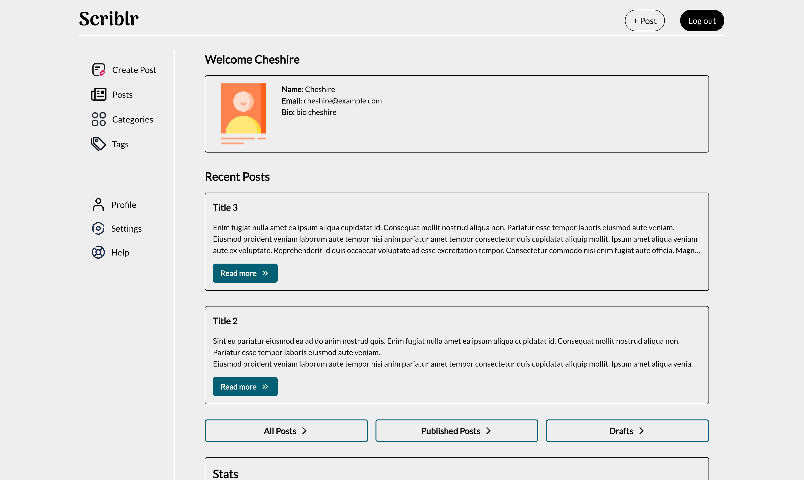
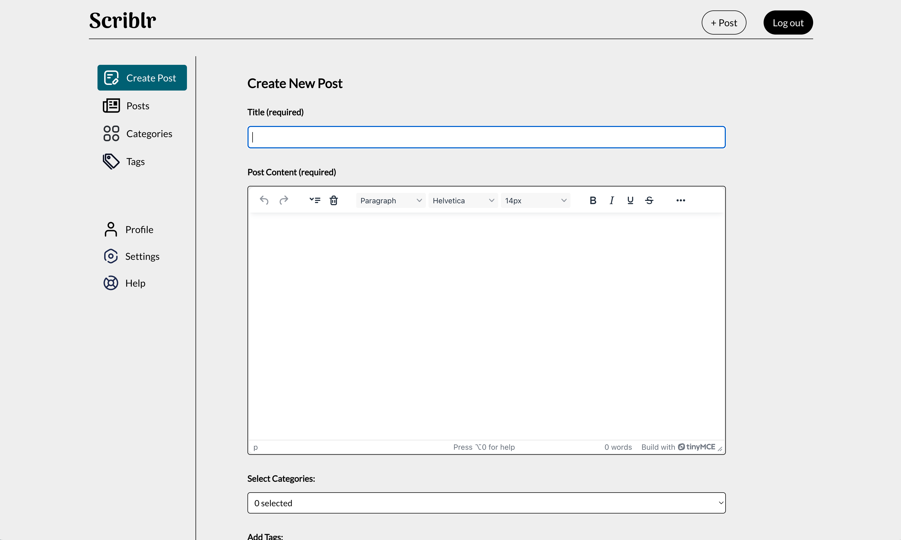
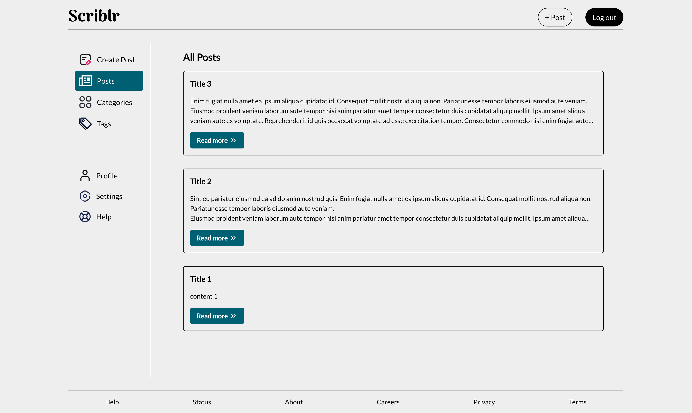
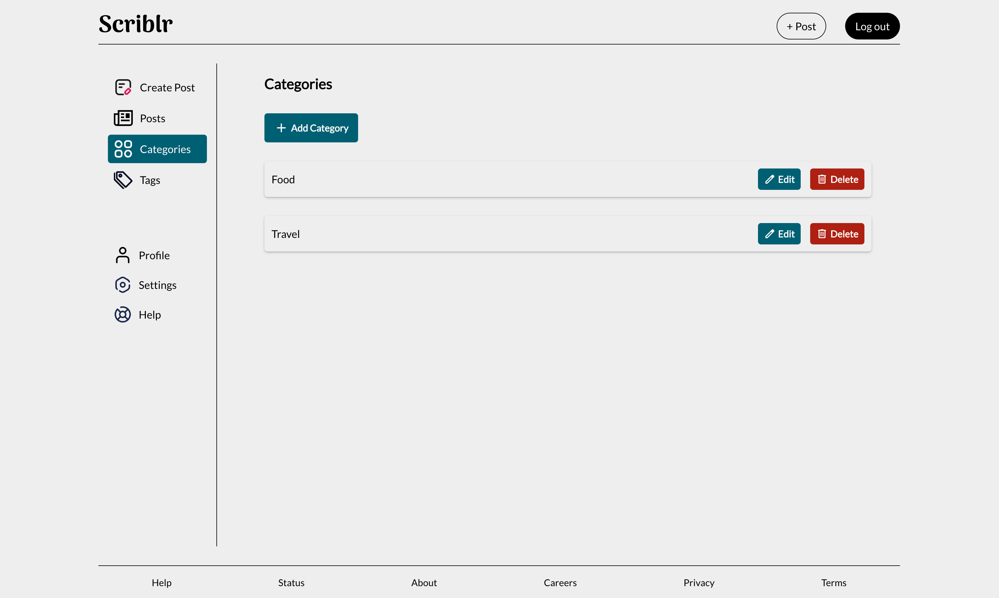

# The Odin Project: Blog API (Author Frontend)

This is a solution to the [Blog API Project](https://www.theodinproject.com/lessons/node-path-nodejs-blog-api) as part of The Odin Project curriculum.

## Table of contents

- [The Odin Project: Blog API (Author Frontend)](#the-odin-project-blog-api-author-frontend)
  - [Table of contents](#table-of-contents)
  - [Overview](#overview)
  - [🚀 Features](#-features)
  - [🖼️ Screenshots](#️-screenshots)
  - [Links](#links)
  - [🛠️ Tech Stack](#️-tech-stack)
  - [📋 Pre-Requisites](#-pre-requisites)
  - [⚙️ Getting Started](#️-getting-started)
  - [📂 Project Structure](#-project-structure)
  - [Credits](#credits)
    - [Images](#images)
    - [Fonts \& Icons](#fonts--icons)

## Overview

Author Blog website is a dedicated React frontend application designed specifically for content creators and authors. It provides an interface where authors can create, edit, and organize their blog posts.

## 🚀 Features

1. Authentication & Session Handling:

- User registration and login interfaces.
- Access restricted routes based on user authentication.
- JWT-based authentication for secure session management.

2. Blog Post Management:

- Interactive post editor with options to publish or save as draft.
- Only text based editor is available for now.
- Option to view all posts, drafts, and published posts.
- Full editing capabilities for existing posts.
- Single-click post deletion.

3. Categories and Tags:

- Create and manage categories and tags for posts.
- Assign categories and tags to posts.
- Option to edit and delete categories and tags.

4. Dashboard:

- View a summary of all posts, drafts, and published posts.
- Access to create new posts, view categories and tags, and manage them.

## 🖼️ Screenshots

<table>
  <tr>
    <td align="center">
      
      <br>
      <em>Homepage</em>
    </td>
    <td align="center">
      
      <br>
      <em>New Post</em>
    </td>
  </tr>
  <tr>
    <td align="center">
      
      <br>
      <em>Posts</em>
    </td>
    <td align="center">
      
      <br>
      <em>Categories</em>
    </td>
  </tr>
</table>

## Links

- [Solution URL](https://github.com/py-code314/file-uploader)

## 🛠️ Tech Stack

- React
- React Router
- Vite
- CSS Modules


## 📋 Pre-Requisites

Before you begin, make sure you have the following tools installed in your machine:


- [Node.js](https://nodejs.org/en/download/)
- npm
- Running instance of **Blog API Backend**


## ⚙️ Getting Started

1. Run `git clone https://github.com/py-code314/blog-api-author` to clone the repository.
2. Run `cd blog-api-author` to navigate to the project directory.
3. Run `npm install` to install dependencies.
4. Create `.env` file and configure the required environment variables based on the `.env.sample` file.
5. Run `npm run dev` to start the development server.


## 📂 Project Structure


```
├── src
│   ├── assets/                    # Static assets (images, fonts, icons)
│   ├── components                 # Reusable React components
│   │   ├── core/                  # Core components (e.g., Button, Modal)
│   │   ├── features/              # Feature-specific components (e.g., Posts, Categories)
│   │   ├── forms/                 # Form components (e.g., LoginForm, SignupForm)
│   │   ├── layouts/               # Layout components (e.g., Header, Footer)
│   │   ├── sections/              # Section-specific components (e.g., Hero, Profile)
│   ├── contexts/                  # Contexts for global state management (e.g., AuthContext, PostContext)
│   ├── hooks/                     # Custom React hooks (e.g., useData)
│   ├── pages/                     # React components representing individual pages (e.g., Home, LandingPage)
│   ├── routes/                    # React Router routes
│   ├── utils/                     # Utility functions (e.g., validateForm)
│   ├── App.jsx                    # Root component
│   ├── index.css                  # Global styles
│   ├── main.js                    # Main entry point
├── .env                          
├── .env.sample                   
├── .gitignore                     
├── eslint.config.js
├── index.html
├── package-lock.json
├── package.json
├── README.md
└── vite.config.js
``` 


## Credits

### Images

- Image **"seashore during golden hour"** by "
  Sean Oulashin" is from [Unsplash](https://unsplash.com/photos/seashore-during-golden-hour-KMn4VEeEPR8)
- Image **"brown and white cat in shallow focus shot"** by "
  傅甬 华" is from [Unsplash](https://unsplash.com/photos/brown-and-white-cat-in-shallow-focus-shot-tEMU4lzAL0w)

### Fonts & Icons

- Fonts and icons are downloaded from [Google Fonts](https://fonts.google.com/)
